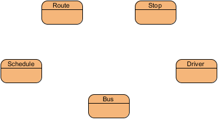
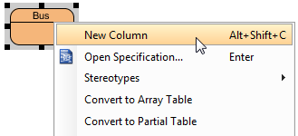
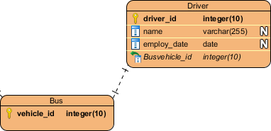
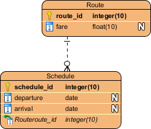
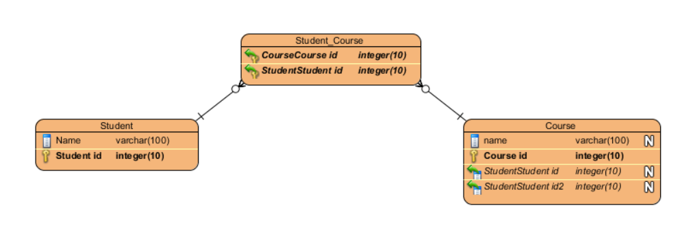
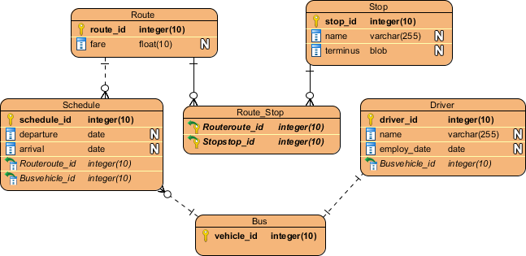

# Drawing ER Diagrams with Visual Paradigm

Here is a guide for you in order to make ER diagrams using Visual Paradigm.

The instructions are based on the [Visual Paradigm database design tutorial](https://s.visual-paradigm.com/tutorials/databasedesign.jsp). The interface may look slightly different depending on the version of Visual Paradigm you use.

## 1. Create a New Project

1. Open Visual Paradigm.
    
2. From the main menu, select **Project → New**.
    
3. Enter a name for your project.
    
4. Select **Create Blank Project** to start with an empty project.
    

Give your project a meaningful name related to your database assignment.

## 2. Create an Entity-Relationship Diagram

1. From the main menu, select **Diagram**.
    
2. Find and select **Entity Relationship Diagram**.
    
3. Enter a name for your diagram, such as `First Draft`.
    
4. Confirm to create the diagram.
    

You should now see an empty diagram canvas and a toolbar containing the elements you can add.

## 3. Add Entities

An **entity** represents a type of object or concept about which the database stores information. For example, a university database might contain entities such as `Student`, `Course`, `Instructor`, and `Department`.

To create an entity:

1. Select **Entity** from the diagram toolbar.
    
2. Click on the canvas where you want to place the entity.
    
3. Enter the entity's name.
    
4. Press **Enter** to confirm.
    

Repeat these steps for the other entities in your database.

## 4. Add Attributes (Columns)

Attributes describe the properties of an entity. For example, a `Student` entity might have `student_id`, `name`, and `email` attributes.

To add an attribute:

1. Right-click the entity.
    
2. Select **New Column** from the context menu.
    
3. Enter the attribute name and its data type.
    
4. Press **Enter** to confirm.
    
5. Repeat for the remaining attributes.
    

In the tutorial's interface, a column can be entered using the following notation:

`attribute_name : data_type`

For example:

- `name : varchar(100)`
    
- `birth_date : date`
    
- `gpa : float`
    

Use data types appropriate to the information being stored. The available types and their syntax may vary by database system and Visual Paradigm version.

## 5. Define Primary Keys

A **primary key (PK)** is an attribute, or a combination of attributes, that uniquely identifies each record in an entity.

For example, `student_id` can identify a student even when multiple students have the same name.

To define a primary key:

1. Add the identifier attribute to the entity.
    
2. Right-click the attribute.
    
3. Select **Include in Primary Key** from the menu.
    
4. Check that the diagram displays the primary key designation.
    

## 6. Create Relationships Between Entities

A **relationship** represents an association between entities. For example, a student enrolls in a course, or an instructor teaches a course.

Visual Paradigm provides relationship tools for connecting entities.

### 6.1 One-to-One (1:1)

Each instance of one entity is associated with at most one instance of the other entity, and vice versa, according to the relationship's participation constraints.

Example: `Person` and `Passport`, if the system requires each person to have at most one passport and each passport to belong to at most one person.

### 6.2 One-to-Many (1)

One instance of an entity can be associated with multiple instances of another entity, while each instance on the many side is associated with at most one instance on the one side.

Example: One `Department` can have multiple `Instructors`.

### 6.3 Many-to-Many (M)

Multiple instances of one entity can be associated with multiple instances of another entity.

Example: A `Student` can enroll in multiple `Courses`, and a `Course` can have multiple students.

In a relational database, a many-to-many relationship is usually implemented using an associative entity or junction table, such as `Enrollment`.

### Drawing a relationship in Visual Paradigm

1. Select the relationship you want from the diagram toolbar. (One_to_One relationship, One_to_Many relationship, Many_to_Many relationship)
    
2. Drag the connector from the one entity toward another entity.
    

## 7. Understand Foreign Keys

A **foreign key (FK)** is an attribute, or a combination of attributes, that references a key in another table to represent a relationship between records.

For example, if each course belongs to one department, the `Course` table might contain a `department_id` foreign key referencing `Department.department_id`.

When you create a relationship, Visual Paradigm may offer to create or map foreign keys automatically. Review the result to make sure that the generated attributes and references match your intended design.

Typical relational mappings are:

- **One-to-many:** The foreign key is generally placed on the many side.
    
- **One-to-one:** A foreign key with an appropriate uniqueness constraint can implement the relationship.
    
- **Many-to-many:** An associative table typically contains foreign keys referencing both participating entities.
    

## 8. Arrange and Review the Diagram

After adding the entities, attributes, and relationships:

1. Arrange the entities so that the diagram is easy to read.
    
2. Avoid unnecessary crossings between relationship lines.
    
3. Make sure entity and attribute names are readable.
    
4. Check that primary keys are clearly identified.
    
5. Check that the relationships and their cardinalities match the requirements.
    

Your ERD should communicate the database structure clearly without requiring the reader to guess what the relationships mean.

    